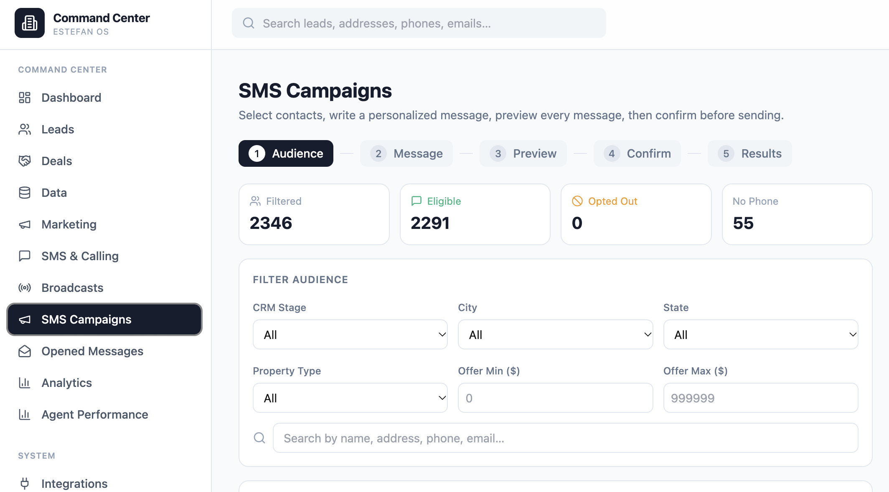

# ESTEFAN OS — CRM & Sales Workflow Design

**Role:** Independent product builder and workflow designer  
**Platform:** Base44 · AI-assisted application development

## Overview

ESTEFAN OS is a custom CRM application designed around the needs of sales and business development teams. It brings lead management, pipeline visibility, audience filtering, and communication workflows into a centralized interface.

My hands-on background in prospecting, customer acquisition, and account management informed the product's structure and prioritization.

## Featured workflow: SMS campaign builder

The interface organizes a campaign into five stages:

**Audience → Message → Preview → Confirm → Results**

The audience view offers filtering by CRM stage, location, property type, and offer range, with separate indicators for eligibility and missing contact information. The staged approach helps operators review an audience and its message before proceeding.

## Design approach

I used AI-assisted development tools to translate operational goals into specific interface requirements, refine the output, and review the resulting screens. A useful specification defines not just the main path but also different states, user decisions, and expected feedback.

## Skills demonstrated

- CRM and sales workflow design
- AI-assisted application development
- UX and staged interaction design
- Audience segmentation and communication planning
- Prompt iteration and product requirements

## Development

ESTEFAN OS is an independently developed project. The screenshot shows the application interface; integrations and campaign delivery behavior should be assessed separately from UI design.
